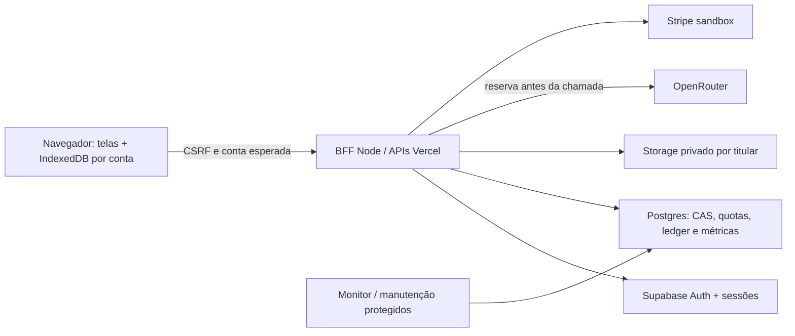

# Arquitetura atual — NutriFoto 0.2.0

> Atualização da rodada real de 21/10/2026: quatro requisições OpenRouter (duas gerações), 9.056 tokens, US$ 0,00145245 informados; rodada encerrada. Dois defeitos adicionais corrigidos: TACO incompleta e campo opcional undefined no backup. Testes atuais: 48 casos Node distintos aprovados considerando Postgres separado; 26 cenários gerais e 12 adicionais. Consulte RELATORIO_HOMOLOGACAO_REAL.md e RELATORIO_ATUALIZADO_PARA_CHATGPT.md. Serviços comerciais permanecem pendentes.

Data: 21/10/2026. Estado: implementação local concluída para homologação; integrações remotas ainda não homologadas. Nenhum deploy ou pagamento Stripe foi realizado. A rodada autorizada de IA real está documentada nos relatórios novos; não altera a falta de homologação dos demais serviços.

## Tecnologias e organização

Frontend funcional em HTML5/CSS/módulos JavaScript, sem framework nem classes próprias. Tipografia Space Grotesk; Chart.js 4.5.1, Lucide 1.61.0 e @fontsource/space-grotesk 5.3.0 locais. Node >=22 no backend; pnpm 11.25.0 e lockfile único. Desenvolvimento: Playwright, Acorn e fake-indexeddb. Capacitor foi retirado das dependências ativas; alvo nativo pausado.

- `www/index.html`: shell e painel. Cada fragmento de `www/telas/` possui uma tela: captura, resultados, histórico, configurações, plano, tutorial, conta e privacidade.
- `www/js/app.js`: inicialização e ligação de eventos; `navegacao.js`: carregamento e rotas lógicas `/?tela=...`, histórico do navegador. Fragmentos não são páginas autônomas de entrada.
- `base.js`, `painel.js`, `captura.js`, `resultados.js`, `edicao.js`, `historico.js`, `configuracoes.js`, `plano.js`, `lembretes.js`, `tutorial.js`: responsabilidades de interface.
- `nutricao.js`, `tacoSearch.js`, `foodAlternatives.js`, `promptPlano.js`: domínio nutricional e contratos; aliases de integrações antigas são mantidos onde necessários.
- `db.js`, `storage.js`, `datas.js`, `dadosValidacao.js`, `backup.js`: persistência local e validação.
- `servicoHttp.js`, `conta.js`, `sincronizacao.js`, `imagensRemotas.js`: conta, transporte, fila e fotos privadas.
- `api/`: handlers Vercel de conta, dados, imagens, IA, assinatura, webhook e manutenção.
- `servidor/`: aplicação HTTP, segurança, adaptadores REST, IA, pagamento, imagens, manutenção, servidor local e simulador isolado.
- `supabase/001_comercial.sql`, `002_storage.sql`: esquema, funções transacionais, permissões e bucket privado.
- `testes/`, `.github/workflows/validar.yml`, `scripts/`: verificação e build. `DESIGN.md` e `UX-CONTRACT.md` registram decisões de UI.

## Contas e segurança

O navegador chama apenas APIs da mesma origem. O BFF Node fala com Supabase Auth usando a API oficial; não implementa armazenamento próprio de senhas de produção. Há cadastro, login, logout, recuperação e redefinição. Sessão usa cookies HttpOnly, SameSite Strict, Secure em produção; tokens não ficam em localStorage. O servidor verifica usuário no Auth e a propriedade/vigência da sessão em `auth.sessions` antes de acessar dados. O simulador local usa contas fictícias e não equivale a Supabase homologado.

Mutações exigem origem autorizada e token CSRF. Identidade vem da sessão, nunca de `usuario` no corpo. RPCs/tabelas não são acessíveis por anon/authenticated; funções SECURITY DEFINER com search_path vazio e grants restritos a service_role atendem o backend. RLS e checagens de proprietário complementam isso. Proteger a service_role continua essencial.

CSP restringe scripts, fontes e conexões à própria origem; imagens permitem data/blob. Styles inline permanecem para gráficos/layout existente. Há escaping/textContent, schemas no cliente e novamente no servidor, limites de corpo/resposta/tempo, sem retorno de erros secretos dos provedores. Logs incluem evento, identificador operacional, status/duração e ciência técnica da IA, sem texto, foto, e-mail, senha ou token. Cabeçalhos de proteção são definidos em `vercel.json` e servidor local.

Limites persistentes: 120 pedidos/minuto por rede, 90/minuto por usuário, 15 tentativas de conta/15 minutos. NAT pode agregar pessoas; ajuste somente após medir homologação. Limitação não substitui proteção de borda/monitoramento de abuso.

## Persistência e sincronização

IndexedDB v4 usa coleções de refeições, resumos sem fotos, peso, água e estado de sincronização; índices de dia e operação, transações aguardando conclusão e IDs aleatórios de 52 bits. O banco antigo `nutrifoto` é preservado. Cada conta usa `nutrifoto.conta.<id codificado>` e preferências próprias. Login não copia automaticamente dados legados; a ação explícita mantém o original. Logout/troca limpa resultados e interrompe operações da UI. Dados locais permanecem no dispositivo; não há criptografia local própria e dispositivos compartilhados exigem cuidado.

Datas de calendário são locais; instantes têm createdAt separado. Dashboard lê resumos, histórico pagina 30 dias e detalhes carregam fotos sob demanda. Backup JSON v1 inclui refeições/imagens, água, peso, perfil, plano, metas, temas, tutorial e preferências, sem credenciais. CSV é resumo, não backup integral. Importação tem validação, confirmação de mesclar/substituir e rollback em falhas normais de armazenamento. Não existe atomicidade entre IndexedDB e localStorage diante de queda abrupta do navegador.

Registros antigos incompletos ou incompatíveis são preservados inertes em `preferencias.registrosParaRevisao` no backup, sem aplicação a metas/totais; não são descartados silenciosamente. O banco original permanece disponível. Revisão manual de dados legados pode ser necessária.

A sincronização envia snapshot de metadados autenticado com revisão CAS e UUID persistido na outbox. Repetição da mesma operação não duplica. HTTP 409 exige escolha explícita sobre conflito; não há CRDT nem fusão automática de alterações simultâneas. Sincroniza após mudanças com debounce, login e reconexão. O estado da fila sobrevive a reload; conta/tentativas antigas não podem sobrescrever outra conta.

O servidor limita metadados a 3,8 MB e 10.000 registros por coleção. Fotos saem do snapshot, usam hash SHA-256 e bucket privado com caminho do proprietário, máximo 1 MB/foto e quota cumulativa configurável. Upload/download passam pelo BFF; não há bucket público nem URL de acesso permanente. Backup busca fotos remotas ausentes ou falha claramente. Arquivo legado muito grande, inclusive fotos arquivadas em preferências, pode exigir revisão/exportação antes de sincronizar.

Exclusão marca a conta, bloqueia novos uploads, aguarda reservas em andamento, remove objetos em lotes de 100 e exclui usuário com cascatas. Apagar localmente não apaga remoto; os backups e retenções dos provedores exigem política operacional. O processo pode exigir nova tentativa após interrupção. Cópias locais em outros dispositivos não são apagadas remotamente de imediato.

## IA e nutrição

Busca exata ou alias inequívoco TACO funciona sem conta e sem chave. Mantém preparo/tipo/corte; ambiguidade pede confirmação. Nutrientes guardam origem precisa e representam a porção atual; redimensionar aplica a escala uma vez, somatórios são determinísticos. A base tem 597 identidades; 582 possuem nutrientes utilizáveis e 15 não atendem aos critérios atuais. Identidade exata não garante dados de composição completos. Referência incompleta não recebe selo nutricional nem substitui estimativa válida; a busca direta avisa antes de oferecer IA. TACO é referência de composição, não medição do prato ou garantia clínica.

IA exige sessão, ciência técnica explícita por sessão e reserva transacional de quota mensal. O navegador nunca recebe a chave OpenRouter. Modelo servidor fixado em `openai/gpt-4o-mini`, no máximo 1.500 tokens para análise e 3.500 para plano; IA_MAX_TOKENS_ANALISE permite reduzir a análise para inteiro 128–1500 (padrão 1500, teste real 700); timeout externo 25 s e cliente 35 s abrangendo corpo, com cancelamento. Resposta JSON é validada e somas recalculadas. Custo/tokens retornados são registrados quando disponíveis; preço não é inventado. Reserva é conservadora: falhas podem consumir cota, evitando repetição automática cobrada. Cancelar a UI não garante cancelar processamento já enviado ao provedor.

Fotos têm validação de tipo, tamanho e assinatura; no cliente são reduzidas a 1.024 px. O envio à IA aceita cerca de 2 MB binários; armazenamento privado tem limite separado de 1 MB. Há limites de decodificação e erros visíveis. Não houve avaliação de acurácia visual com pratos reais.

Planos são rascunhos com revisão profissional obrigatória. `PLANOS_HOMOLOGADOS=false` bloqueia geração externa. Mesmo após ativar, menores, gestação/condições de acompanhamento, alergias ou restrições são bloqueados no automático. Preferências são separadas; filtros de alternativas e validação de incompatibilidades são conservadores, sem certificar ingredientes/contaminação cruzada. Troca recalcula quantidade e nutrientes; macros têm container próprio. Aplicar metas de um rascunho está bloqueado na UI. Merge parcial de metas preserva água, testado separadamente.

## Assinatura e monetização

Stripe somente sandbox: chaves sk_live e eventos livemode são recusados. Preço, limites grátis/pago e orçamento de armazenamento são decisões humanas; padrão de quotas/armazenamento é zero. O simulador devolve indisponibilidade para checkout; não simula pagamento aprovado.

Cliente Stripe é vinculado no servidor. Uma intenção persistente por conta reutiliza chave e expiração de checkout por 24 h entre cliques/dispositivos; bloqueia troca de preço enquanto vigente e recusa compra adicional quando já há assinatura. Tentativa cancelada pode retornar à mesma sessão até expirar. Portal é servidor. Nenhum retorno de URL concede plano.

Webhook verifica HMAC e janela temporal sobre corpo bruto, recupera assinatura no Stripe, confere preço e reconcilia assinaturas. Eventos duplicados/fora de ordem não devem conceder acesso incorreto; vigência é conferida no banco. Fluxos reais de checkout, cartão de teste, portal, cancelamento, reembolso e eventos externos ainda exigem homologação. Cobrança real permanece bloqueada por código.

## Offline, operação e escala

Service worker guarda apenas assets estáticos locais; `/api/` nunca entra no cache. Reabertura offline e consulta TACO foram testadas após instalação do cache. IA, login e sincronização precisam de rede. Atualização do worker usa ciclo normal, sem forçar recarregamento no meio de edição. A versão do cache deve ser incrementada a cada release que altere assets; homologar atualização/instalação em dispositivos reais antes de divulgar como PWA plenamente suportada.

Lembretes recorrem por relógio local a cada 30 s enquanto a página está aberta/ativa; não prometem push com app fechado ou suspensão. Não há scheduler nativo homologado.

Vercel executa BFF sem estado de quota em memória; PostgreSQL concentra CAS, limites e idempotência. Fotos são separadas, mas o snapshot de metadados continua limitado e não é arquitetura de histórico ilimitado. Carga local não mede escalabilidade cloud. Medir p95/p99, erros, filas, custo por usuário, conexão/latência do banco e armazenamento antes de vender. Estabelecer alertas, suporte e resposta a incidentes. `GET /api/manutencao` requer `Authorization: Bearer <CRON_SECRET>` com segredo de pelo menos 32 caracteres; cron diário em `vercel.json`. Limpa contadores antigos (1 dia), resultados operacionais (7 dias) e eventos (90 dias); não apaga o diário. Retenção de logs/backups deve ser configurada separadamente.

## Executar e homologar

Para demo local, siga README/BUILD. Para ambiente remoto, o proprietário deve criar projetos separados de homologação, sem dados reais inicialmente:

1. Revogar/rotacionar a chave exposta anteriormente, verificar acessos/custos/artefatos históricos. A remoção da árvore atual não revoga a credencial. Não foi reescrito histórico Git.
2. Criar Supabase Auth/Postgres/Storage; aplicar 001 e depois 002 uma vez em banco novo; verificar grants, bucket privado e política de e-mail. Não reaplicar 001 cegamente em banco existente: contém criação de policies. Fazer backup e revisão de migração antes de qualquer banco existente.
3. Preencher variáveis do `.env.example` somente no servidor: APP_ORIGIN exata, URLs/chaves Supabase, RATE_LIMIT_SALT aleatório, OpenRouter, quotas/orçamento, Stripe test/price/webhook e CRON_SECRET. Não aproveitar credencial antiga. Liberar rede externa apenas para homologações autorizadas.
4. Configurar Site URL e allowlist do Supabase, SMTP de teste, confirmação de cadastro e template de recuperação com `{{ .SiteURL }}/?tela=conta#recuperacao={{ .TokenHash }}`. O BFF verifica o TokenHash; fragmento é removido imediatamente e não enviado ao servidor web. Templates padrão que entregam access_token no navegador não substituem esse fluxo. Testar e-mails reais com caixas de teste autorizadas. Referência: https://supabase.com/docs/guides/auth/auth-email-templates.
5. Registrar webhook de testes em `/api/webhook`, configurar preço sandbox sem inventar valor comercial, testar eventos reais com reenvio/ordem/expiração e checkout concorrente. Aprovar política de oferta, suporte/cancelamento/reembolso antes de venda.
6. Aprovar privacidade/termos com responsável e contato, bases legais, dados sensíveis, operadores, transferências e retenção; revisar nutrição e público. A tela `privacidade.html` é minuta, não parecer jurídico.
7. Ensaiar restauração de banco E objetos privados, exclusão/revogação, perda de resposta e falha de provedor em homologação. Backups de banco Supabase não contêm os objetos Storage: https://supabase.com/docs/guides/platform/backups. Excluir objetos pela API Storage, não só linhas SQL: https://supabase.com/docs/guides/storage/management/delete-objects.
8. Executar CI em GitHub e testes em celulares/navegadores/leitor de tela; medir carga/custos remotos e alertas. Revisar commit interno e gitlink da raiz antes de release. Nenhuma dessas ações externas foi executada automaticamente.

## Graphify e limites da análise

Grafo AST local atualizado sem extração paga, consulta focada conferida no código; snapshot final em `../graphify-out/`. Detecta módulos de domínio, backend, dados e sincronização separados. Contém também auxiliares de auditoria e arquivos históricos; contagens não medem qualidade nem cobertura. Consultas de 800 tokens foram truncadas e usadas apenas para localizar módulos; dependências efetivas foram lidas diretamente. Houve aviso de colisão de rótulo `$` em `base.js`; não se infere ausência de relações a partir dessa falha da ferramenta.

## Harness isolado da rodada real

`testes/homologacao-real.js` usa BFF e frontend reais em loopback, com autenticação/banco temporários e transporte de IA controlado. `testes/apoio/controle-ia-real.js` lê a chave só no servidor, registra chamadas/custos antes de prosseguir e reaproveita respostas reais gravadas. Uma reserva pendente/erro ambíguo interrompe chamadas. O limite de cinco inclui GET key/models; quatro foram realizadas e a rodada foi encerrada. Este harness não é modo de produção, não é ativável por corpo HTTP e não entra em CI automaticamente. Não apagar controle nem renovar a rodada sem nova autorização. Planos externos continuam bloqueados, sem flag permanente de liberação. Detalhes e limites em RELATORIO_HOMOLOGACAO_REAL.md.

## Atualização comercial de 22/10/2026

A arquitetura descrita acima foi ampliada, preservando o frontend nativo e o BFF. Fonte atual detalhada em IMPLEMENTACAO_COMERCIAL.md e RELATORIO_DEFINITIVO_PARA_CHATGPT.md. Novos módulos: comercial.js (capacidades), custos.js (reserva financeira), operacao.js (métricas), chavesIa.js (intenção cliente) e atualizacao.js (PWA). SQL003 acrescenta ledger/orçamento/bloqueios financeiros/retenção/inventário; SQL004 contém métricas. Somente o serviço executa RPCs comerciais.

Há prova da jornada navegador/BFF HTTPS/Supabase real local, usando CA temporária só no teste e SMTP Mailpit. Não equivale a homologação cloud. Conexão a Stripe permanece testada com fixtures; produção financeira é recusada. Dados alimentares não entram nos logs de métricas.

O Graphify foi consultado no início da missão. Na retomada, o executável local retornou uv trampoline failed to canonicalize script path; sem ser essencial para editar arquivos conhecidos, a investigação continuou por leitura direcionada. graphify-out/ preserva o mapa anterior; não o chamar de mapa atualizado das mudanças comerciais. Não houve watcher, extração semântica paga nem alteração do agregado global.
